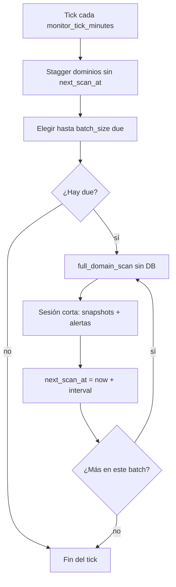

# Programación del escaneo automático en FacuTools

Documento de diseño operativo (estado actual ≈ **v1.1.4** — cola por dominio).

---

## 1. Resumen en una frase

El scheduler **no barre todo el portfolio de golpe**. Cada minuto (tick) toma **como máximo N dominios vencidos** (default **1**), los escanea en secuencia, y agenda el próximo scan de ese dominio para dentro de M minutos. Así la API no se bloquea con un batch masivo.

---

## 2. Modelo: cola `next_scan_at`

Cada fila en `domains` tiene:

| Campo | Significado |
|--------|-------------|
| `last_scanned_at` | Último scan automático/manual exitoso |
| `next_scan_at` | Cuándo vuelve a estar “due” |

### Settings (Monitoring)

| Key | Default | Rol |
|-----|---------|-----|
| `monitor_interval_minutes` | 30 | Cadencia **por dominio** (cada cuánto se reescanea el mismo) |
| `monitor_tick_minutes` | 1 | Cada cuánto el scheduler mira la cola |
| `monitor_batch_size` | **1** | Máx. dominios por tick (1 = totalmente secuencial) |
| `ssl_monitor_interval_minutes` | 60 | Job SSL aparte (batch de certificados) |

Ver estado en **Settings → Monitoring** o `GET /api/settings/schedule`.

---

## 3. Timeline

```
t=0s      API up → scheduler start (sin scans)
t≈90s     Primer tick de dominios (BOOT_SCAN_DELAY)
          → stagger de next_scan_at si estaban en NULL
          → escanea hasta batch_size dominios due
t=90s+1m  Siguiente tick… solo los que ya vencieron
…
cada dominio: después de escanearse → next_scan_at = now + interval
```

### Ejemplo (10 dominios, interval=30, tick=1, batch=1)

1. Al primer tick se **reparten** los `next_scan_at` a lo largo de ~30 min (stagger).
2. Cada tick escanea **1** dominio due.
3. Nunca hay 10 `full_domain_scan` seguidos en el mismo segundo.
4. La API sigue atendiendo `/auth/me` y el resto entre ticks y durante el I/O de red (sesión DB corta solo al persistir).

---

## 4. Flujo por tick



---

## 5. Qué hace un scan (igual que antes)

WHOIS/RDAP, DNS, SSL live, health, email, tech, subdominios, alertas por umbral y por **diff** vs snapshot.

**Blacklists:** solo si `blacklist_scan_auto_enabled` está activo (entonces perfil **full**, ~32 listas). Si está apagado, el scan de dominio las omite; usá `POST /domains/{id}/scan-blacklists` (botón en la ficha).

Manual (`POST /domains/{id}/scan`) usa la misma persistencia y también actualiza `last_scanned_at` / `next_scan_at`.

---

## 6. Cómo configurarlo para “que no bloquee nada”

Recomendado en Settings → Monitoring:

1. **Domains per tick (`monitor_batch_size`) = 1**
2. **Monitor tick = 1** minuto
3. **Domain monitor interval** = 30 (o lo que necesites por dominio)

Si el portfolio crece y querés ir un poco más rápido sin saturar: `batch_size = 2` como máximo razonable en el mismo proceso API.

No subas el batch a “todos los dominios”: eso vuelve al problema viejo.

---

## 7. Limitaciones que quedan

- El job **SSL** (`ssl_monitor`) sigue siendo un barrido de certificados en su propio intervalo (no cola por cert todavía).
- Todo vive **in-process** con la API (mitigado, no un worker aparte).
- Un dominio que tarda mucho en red sigue ocupando ese tick; el siguiente tick espera (`max_instances=1`).
- Tras reinicio: delay ~90 s y re-stagger solo de filas con `next_scan_at` NULL.

---

## 8. Alternativas si esto no alcanza

| Enfoque | Cuándo |
|---------|--------|
| Capas Fast/Standard/Heavy | Downtime cada 5 min sin WHOIS/DNSBL cada vez |
| Worker + cola (Redis/RQ) | Portfolio grande o SLA estricto de API |
| Intervalo por dominio/prioridad | Algunos “críticos” más seguidos |

---

## 9. Código clave

- `backend/app/scheduler.py` — `monitor_due_domains`
- `backend/app/models.py` — `Domain.next_scan_at` / `last_scanned_at`
- `backend/app/services/domain_service.py` — agenda próximo scan al persistir
- Settings UI — Monitoring + estado del scheduler

---

*Si cambiás batch/tick/interval, guardá Settings: se llama `reschedule_jobs()` automáticamente.*
